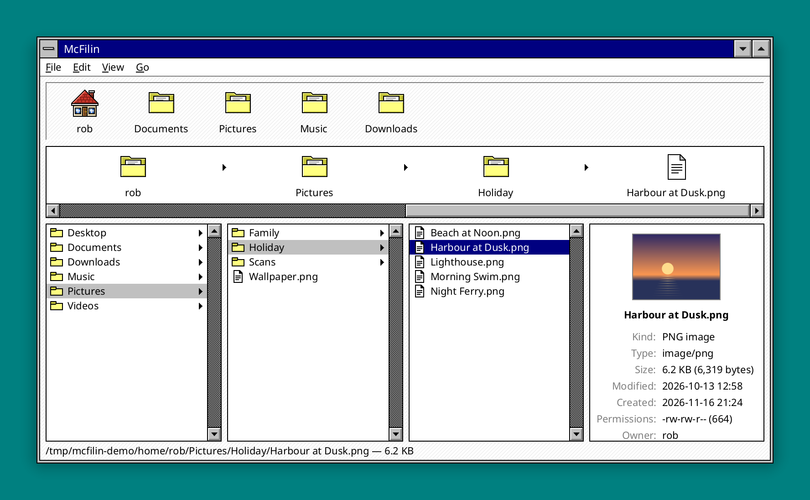

# McFilin

[](https://github.com/roblillack/mcfilin/actions/workflows/ci.yml)

A file viewer with Miller columns, after NeXTSTEP's File Viewer, built on the
[Saudade](https://github.com/roblillack/saudade) toolkit.



<!--
The screenshot is rendered by examples/readme_screenshot.rs, which opens the
real window on a made-up home folder and draws it offscreen through saudade's
MockBackend, in window chrome and at 2×. Refresh it with
`cargo run --example readme_screenshot`, then `pngcrush -ow docs/screenshot.png`.
-->

```
mcfilin        # open in the home folder
mcfilin PATH   # open at PATH
```

Folders kept at hand on the shelf, the path as icons, file info and
thumbnails, drag and drop, and cut, copy and paste of files.

## Installation

Download a binary for Linux, macOS or Windows from the
[releases](https://github.com/roblillack/mcfilin/releases), or build it from a
checkout:

```sh
make
sudo make install
```

This installs the program, its desktop entry and its icon under `/usr/local`.
On Linux, the build needs the Wayland and xkbcommon development packages
(`libwayland-dev libxkbcommon-dev pkg-config` on Debian / Ubuntu).

## License

[MIT](LICENSE)
